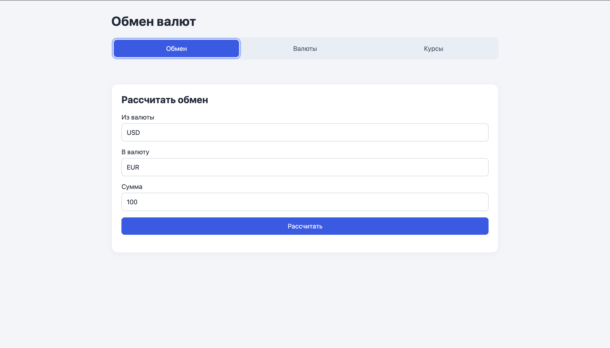

# Currency Exchange

A Java web application for managing currencies and exchange rates
and calculating currency conversions.

The project includes a REST API and a browser interface.
Built without backend frameworks as part of Sergey Zhukov's
[Java Backend Learning Course](https://zhukovsd.github.io/java-backend-learning-course/projects/currency-exchange/).

## Features

- List, find and add currencies.
- List, find, add and update exchange rates.
- Convert amounts using:
    - a direct exchange rate;
    - an inverse exchange rate;
    - a cross rate through USD.
- Manage data through a browser interface.
- Automatically create database tables on application startup.

Exchange rates are entered manually. The application does not fetch
live market rates.

## Technologies

- Java — developed with JDK 25
- Maven
- Jakarta Servlet API 6.0
- Apache Tomcat 10.1
- SQLite and JDBC
- Gson
- JUnit Jupiter
- HTML, CSS and JavaScript



## Architecture

- `controller` — HTTP requests, input validation and JSON responses.
- `service` — exchange rate selection and conversion calculations.
- `dao` — SQL queries and mapping database rows to Java objects.
- `model` — currencies, exchange rates and conversion results.
- `db` — database connections and schema initialization.
- `config` — application startup listener.

The frontend is located in `src/main/webapp`.

## Requirements

- JDK 25
- Maven 3
- Apache Tomcat 10.1

## Configuration

| Environment variable | Description |
| --- | --- |
| `CATALINA_HOME` | Path to the Tomcat installation; required for running through Cargo |
| `CURRENCY_DB_PATH` | Optional path to the SQLite database file |

Default database location:

```text
<user-home>/tools/currency-exchange.db
```

The database directory and tables are created automatically.
A new database starts without currencies or exchange rates.

## Run in IntelliJ IDEA

1. Open the project and import its Maven configuration.
2. Set the project SDK to JDK 25.
3. Create a Maven run configuration.
4. Set the working directory to the project root.
5. Set the command to:

   ```text
   package cargo:run
   ```

6. Add the `CATALINA_HOME` environment variable with the path to your
   Tomcat installation.
7. Run the configuration.

Open:

http://localhost:8080/currency-exchange/index.html

## Run from the terminal

Example for macOS or Linux. Replace the Tomcat path with your own:

```bash
export CATALINA_HOME="/path/to/apache-tomcat"
mvn package cargo:run
```

To use a different database, set its path before starting:

```bash
export CURRENCY_DB_PATH="/path/to/data/currency-exchange.db"
```

## Try the application

For a new database:

1. Open the Currencies section.
2. Add USD:
    - name: `United States dollar`
    - sign: `$`
3. Add EUR:
    - name: `Euro`
    - sign: `€`
4. Open the Rates section.
5. Add a demonstration rate from USD to EUR: `0.95`.
6. Open the Exchange section and convert `100 USD` to `EUR`.

Expected result: `95 EUR`.

The rate above is a demonstration value, not a live market quote.

## REST API

Paths below are relative to `/currency-exchange`.

| Method | Endpoint | Description |
| --- | --- | --- |
| GET | `/currencies` | List currencies |
| GET | `/currency/USD` | Find a currency by code |
| POST | `/currencies` | Add a currency |
| GET | `/exchangeRates` | List exchange rates |
| GET | `/exchangeRate/USDEUR` | Find a directional exchange rate |
| POST | `/exchangeRates` | Add an exchange rate |
| PATCH | `/exchangeRate/USDEUR` | Update an exchange rate |
| GET | `/exchange?from=USD&to=EUR&amount=100` | Calculate a conversion |

POST and PATCH bodies use `application/x-www-form-urlencoded`.

### Add a currency

Fields: `code`, `name`, `sign`.

```bash
curl -i 'http://localhost:8080/currency-exchange/currencies' \
  --data-urlencode 'code=GBP' \
  --data-urlencode 'name=Pound sterling' \
  --data-urlencode 'sign=£'
```

### Add an exchange rate

Fields: `baseCurrencyCode`, `targetCurrencyCode`, `rate`.

```bash
curl -i 'http://localhost:8080/currency-exchange/exchangeRates' \
  --data-urlencode 'baseCurrencyCode=USD' \
  --data-urlencode 'targetCurrencyCode=EUR' \
  --data-urlencode 'rate=0.95'
```

### Update an exchange rate

Field: `rate`.

```bash
curl -i -X PATCH \
  'http://localhost:8080/currency-exchange/exchangeRate/USDEUR' \
  --data-urlencode 'rate=0.96'
```

### Error responses

Errors contain a JSON message:

```json
{
  "message": "Exchange rate not found."
}
```

Response statuses include:

- `200` — successful read, update or conversion.
- `201` — resource created.
- `400` — invalid or missing input.
- `404` — currency or suitable exchange rate not found.
- `409` — duplicate currency or exchange rate.
- `500` — database access error.

## Calculations

Java calculations use `BigDecimal`.

Rate selection order:

1. Direct rate.
2. Inverse rate: `1 / reverseRate`.
3. Cross rate: `USD-to-target / USD-to-base`.

Division results are rounded to 12 decimal places.
Converted amounts are rounded to 2 decimal places using `HALF_UP`.

## Tests

Run:

```bash
mvn test
```

Unit tests cover:

- Direct conversion.
- Inverse conversion.
- Cross conversion through USD.
- Missing exchange rates.
- Missing currencies.
- Monetary rounding.

Tests use in-memory test doubles for DAO classes.
They do not require Tomcat or modify the SQLite database.